<!-- omit in toc -->
# AI Home Work Wellness Agent

本システムは、室内環境・天気・スケジュールを AI が統合的に判断し、  
LINE チャットでの質問や、健康アドバイスの生成が可能な AI Wellness Agent である  

---

- [デモンストレーション](#デモンストレーション)
- [システム概要](#システム概要)
- [主な機能](#主な機能)
- [システムアーキテクチャ](#システムアーキテクチャ)
- [AI Agent アーキテクチャ](#ai-agent-アーキテクチャ)
- [技術的な工夫ポイント](#技術的な工夫ポイント)
- [使用技術](#使用技術)
- [セットアップ手順](#セットアップ手順)
- [今後の改善ポイント](#今後の改善ポイント)
- [License](#license)

---

# デモンストレーション

## 1. 健康アドバイス定期通知機能

室内の **CO2濃度、温度、湿度** に応じて、室内環境を評価し、  
天気やスケジュールに基づいた健康アドバイスを定期通知してくれる機能  

**室内環境： 良好** のときの通知例:  

  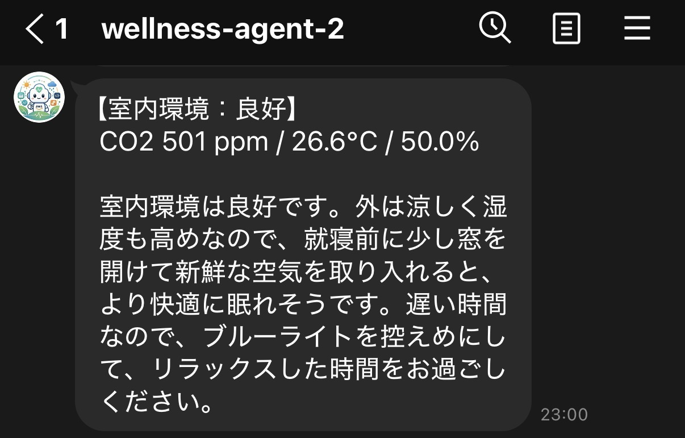

**室内環境： 注意** のときの通知例:  

  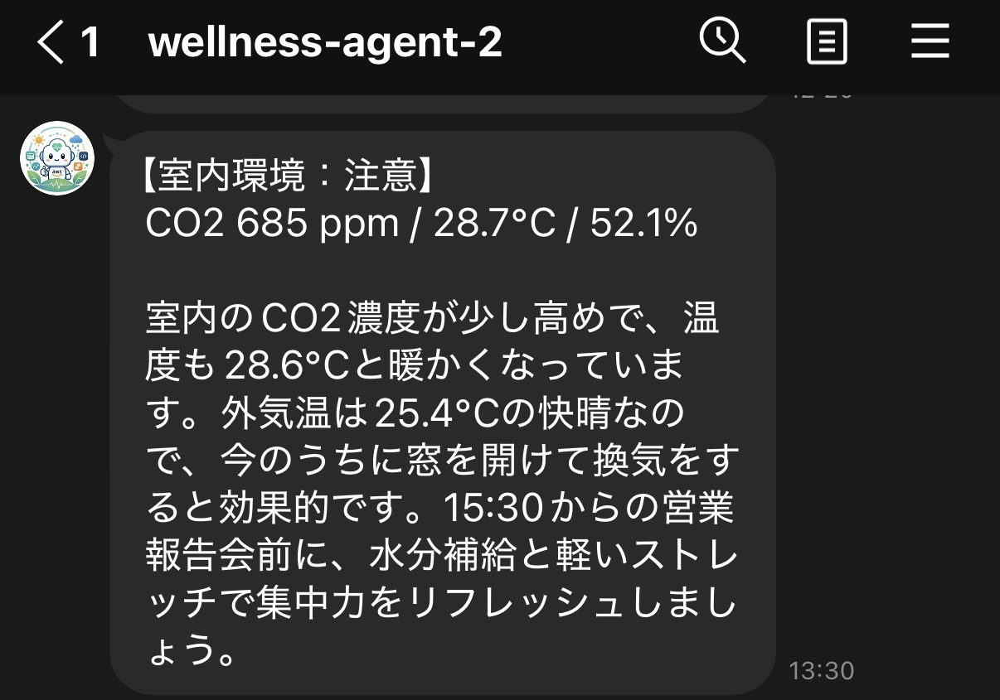

**室内環境： 要対応** のときの通知例:  

  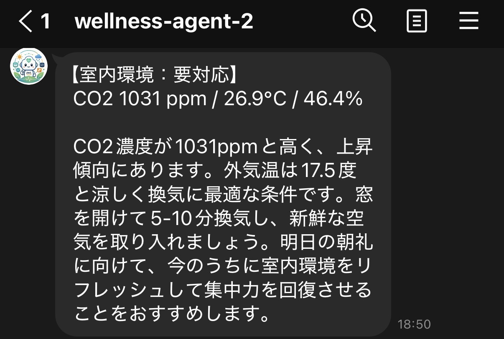

---

## 2. LINE での対話型 AI アシスタント機能

室内環境や天気、スケジュールに関する質問を LINE 上でやりとりできる機能  

**「明日の昼の天気と予定を教えて」** に対する回答例:  

  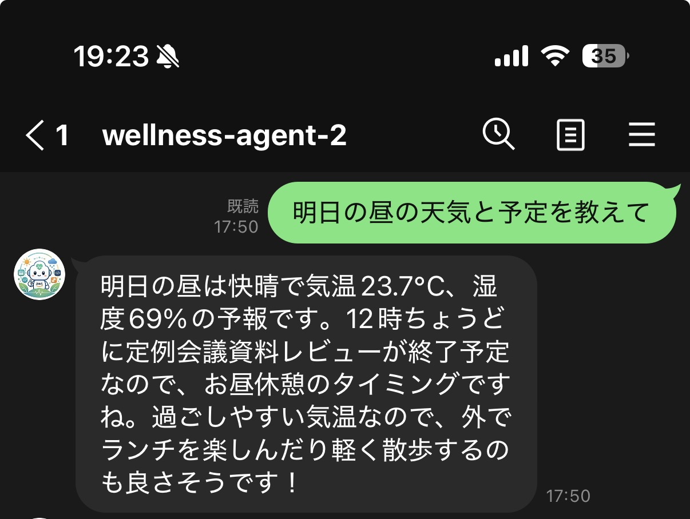

**「明日はどんな1日になりそう？」** に対する回答例:  

  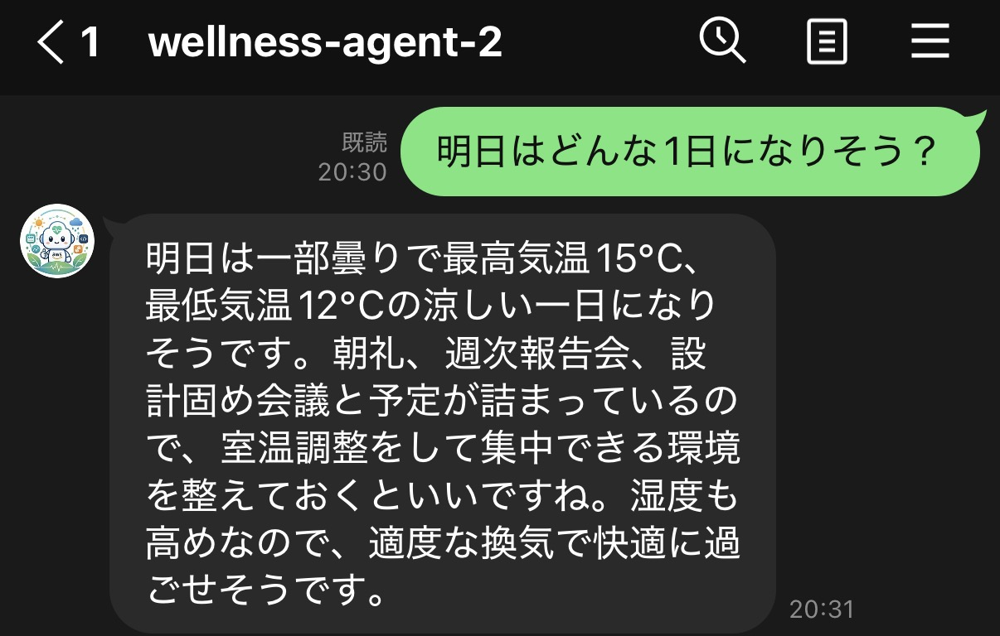

---

## 3. 室内環境レポート生成機能

指定した期間の室内環境のレポートを作成・報告してくれる機能  

**1日の室内環境レポート** の例:  

  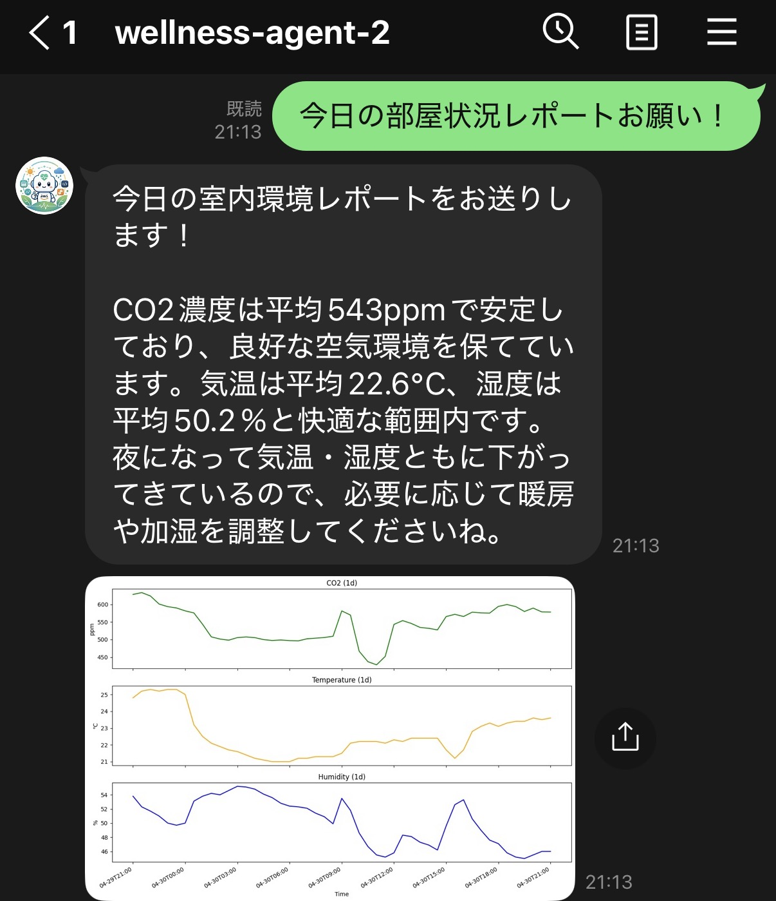

グラフは以下のような画像形式で作成される  

  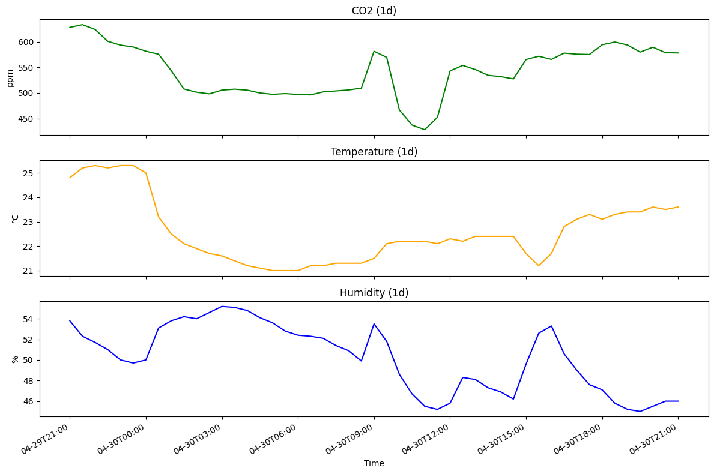

---

### Agent の推論ログ

本システムでは、AI Agent が状況に応じて必要なツールを動的に選択し、最終的な回答を生成する  
Agent が使用可能なツールは以下となる  

| No. | ツール名 | 用途 |
|---|---|---|
| #1 | get_calendar_context_tool | Google Calendar からスケジュールを取得 |
| #2 | get_weather_context_tool | Open-Meteo から天気情報を取得 |
| #3 | generate_sensor_chart_report_tool | 室内データのグラフ画像と要約を取得 |

CloudWatch Logs から、Agent が推論時にツールを選択していることが確認できる  

#### ログ ①: ユーザに「明日の朝の天気と予定」について質問された場合

Agent が `get_calendar_context_tool` と `get_weather_context_tool` の使用を判断し、  
ツールの実行結果を基に最終的な回答を生成していることが確認できる  
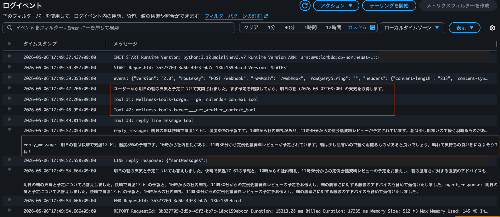

#### ログ ②: ユーザに「1日のCO2濃度の推移」について質問された場合
  
Agent が `generate_sensor_chart_report_tool` の使用を判断し、  
ツールの実行結果を基に室内環境レポートを生成していることが確認できる  
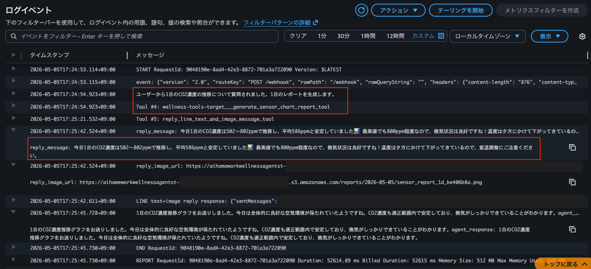

---

# システム概要

在宅ワークで仕事に集中していると、以下の要素に気づきにくい  
これらが原因で、作業効率の低下や体調不良を引き起こす可能性がある  

- 換気不足（CO2濃度上昇）
- 温度 / 湿度の変化
- 過密スケジュール
- 天候の変化

本システムでは、このような情報を基に AI Agent が健康アドバイスを生成し、  
ユーザに LINE 通知することで、作業効率の向上や適切な体調管理を促すことを目的としている  

---

# 主な機能

本システムに搭載されている機能は以下となる  

### 1. 健康アドバイス生成
Agent が以下の情報を取得・統合的に判断し、ユーザに適切な行動提案を LINE 上で通知する  

- センサから得られた室内データ（CO2 / 温度 / 湿度）
- 天気情報（天気 / 最低・最高気温 / 湿度 / 気候アラート）
- Google Calendar スケジュール（1時間以内の予定有無 / 直近の予定3件）

また、Agent は **定期通知** と、**チャット応答** の異なる起動方法に対応している  

### 2. 室内環境レポート生成
Agent が指定期間の室内環境レポートを作成し、LINE 上で報告する  
レポートは以下の要素で構成される  

- 室内データのグラフ画像（CO2 / 温度 / 湿度）
- 室内データの傾向を分析した Agent のコメント

---

# システムアーキテクチャ

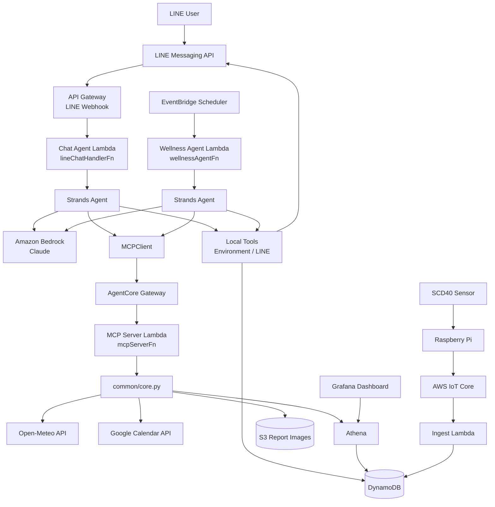

---

# AI Agent アーキテクチャ

## Strands Agent によるツール利用

本システムでは、Strands Agents を使用しており、  
推論を進める中で、複数ツールを動的に選択する AI Agent を構築している  

Agent は以下のコンテキストを横断的に利用して推論を行う  

- 室内環境データ（CO2 / 温度 / 湿度）
- 天気・季節情報
- Google Calendar の予定
- 時刻や時間帯、季節

---

## MCP / AgentCore Gateway によるツール管理

ツール間通信は **MCP Protocol**、ツール管理は **AgentCore Gateway** に統一している  

今回は、以下のメリットを考慮して AgentCore Gateway を採用している  

- Agent とツールを疎結合にすることができる
- ツール実行環境（Lambda / ECS / 外部 API / etc…）を統一的に扱うことができる
- Agent は tool schema を通じて、ツールを動的に認識することができる
- ツール追加時に Agent 側の修正を最小化することができる
  
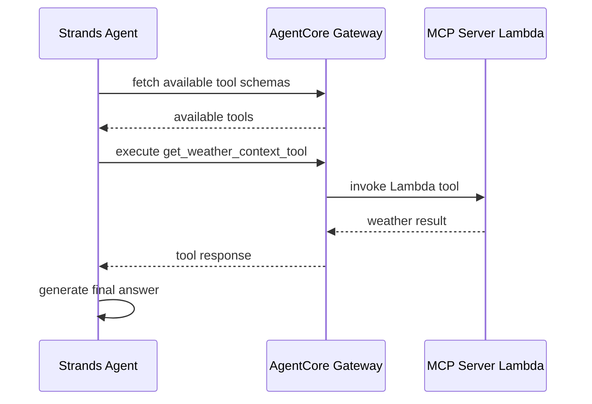

---

# 技術的な工夫ポイント

## 1. 推論ベースのツール選択

Agent は単純なルールベース処理ではなく、  
室内環境、天気、スケジュールなど複数のコンテキストを横断的に利用しながら、  
状況に応じたツール選択や、自然な回答を生成している  

これにより、ユーザの指示に対して Agent が自律的に行動し、柔軟な対応をすることができる  

ツール使用例:  

- ユーザ:「明日の朝の天気と予定を教えて」
- Agent:（明日の朝（5月8日 9:00）の予定を確認してから天気を取得します）
  - get_calendar_context_tool を使用
  - get_weather_context_tool を使用

👉 Agent はツールから得た情報から回答を生成し、LINE に返答する

- ユーザ:「今日の CO2 推移を報告して」
- Agent:（1日の室内環境のデータとグラフを取得します）
  - generate_sensor_chart_report_tool を使用

👉 Agent はツールから得た情報とグラフからレポートを生成し、LINE に返答する

---

## 2. MCP ベースの疎結合アーキテクチャ

Agent は MCP Protocol を通じて Gateway へアクセスし、  
tool schema を動的に取得する構成としている。  

これにより、  

- Agent とツール実装を分離できる
- Lambda / ECS / 外部 API を統一的に扱える
- ツール追加時の Agent 修正を最小化できる
- AgentCore Runtime への移行を容易にできる

など、拡張性の高いツールアーキテクチャを実現している。  

---

## 3. サーバレス構成

本システムは Lambda（MCP Server） + AgentCore Gateway により、  
MCP ベースのツールアーキテクチャをサーバレスで実現している  

従来の MCP Server のように、ツールの管理・公開に ECS などの常駐サーバを必要とせず、  
AWS マネージドな構成で動作する  

---

# 使用技術

| 技術 | 用途 |
|---|---|
| AWS Lambda | Agent / Tool 実行 |
| Amazon Bedrock | LLM 基盤 |
| Strands Agents | AI Agent Framework |
| AgentCore Gateway | MCP Tool 管理 |
| MCP Protocol | Tool 標準化 |
| AWS IoT Core | MQTT ingestion |
| DynamoDB | センサデータ保存 |
| Athena | データ分析 |
| Grafana | データ可視化 |
| LINE Messaging API | ユーザー通知 |
| Raspberry Pi | センサデバイス |
| SCD40 | CO2 / 温湿度センサ |

---

# セットアップ手順

各フェーズの詳細なセットアップ手順や、設計方針をまとめた構想メモは以下となる  
（docs フォルダ配下に格納）  

| ドキュメント | 内容 |
|---|---|
| [00_初期構想・技術選定メモ.md](./docs/00_初期構想・技術選定メモ.md) | プロジェクト立ち上げ時の構想、技術選定理由、MVP設計をまとめた初期メモ |
| [01_IoTCore-ラズパイ接続手順書.md](./docs/01_IoTCore-ラズパイ接続手順書.md) | ラズパイと IoT Core の接続手順書 |
| [02_SCD40接続・MQTT送信手順書.md](./docs/02_SCD40接続・MQTT送信手順書.md) | センサとラズパイを接続し、データを IoT Core に送信する手順書 |
| [03_Grafanaデータ可視化手順書.md](./docs/03_Grafanaデータ可視化手順書.md) | ラズパイから送信したデータを Grafana で可視化する手順書 |
| [04_StrandsAgent化構想メモ.md](./docs/04_StrandsAgent化構想メモ.md) | 単体 Lambda で実装した AI システムを、ツールを使う Agent にバージョンアップするための方針検討内容 |
| [05_ツールMCP化構想メモ.md](./docs/05_ツールMCP化構想メモ.md) | ツールを MCP Server Lambda 上で実行するための方針検討内容 |
| [06_AgentCore化構想メモ.md](./docs/06_AgentCore化構想メモ.md) | ツールを AgentCore Gateway で管理するための方針検討内容 |

---

# 今後の改善ポイント

現時点でも実用的な AI Agent として動作しているが、  
より本格的なシステムへと改善するために、以下の方針を検討している  

### AgentCore Runtime への移行

ツール管理だけでなく Agent 実行までを AgentCore に統合することで、
より AgentCore ネイティブな構成にすることができる  

### AgentCore Memory によるコンテキスト保持

Agent に短期記憶を持たせることで、  
ユーザとの過去会話や行動履歴を踏まえた応答を実現する  

### AgentCore Observability 強化

Agent の挙動や性能を継続的に監視・分析するため、  
セッション数、レイテンシ、実行時間、トークン使用量、エラー率などを可視化する  

### マルチ Agent 化

複数の Agent や、より多彩なツールをシステムに追加することで、  
AI システムとしての機能性や専門性を高める  

### 長期行動分析

LINE チャットをする中で、Agent がユーザの行動特性や嗜好を判断し、  
よりユーザに最適化された回答ができるようにする  

---

# License

MIT
